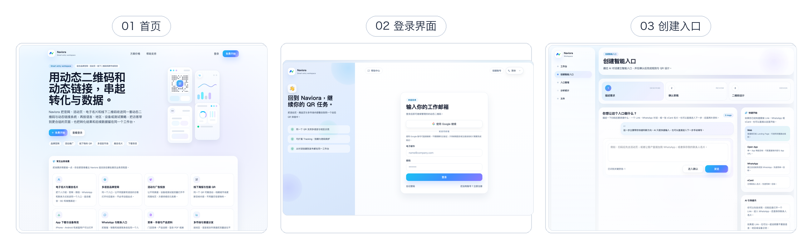
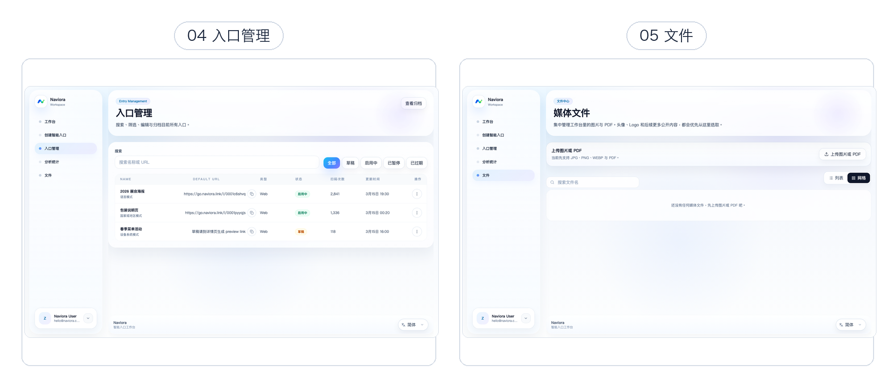
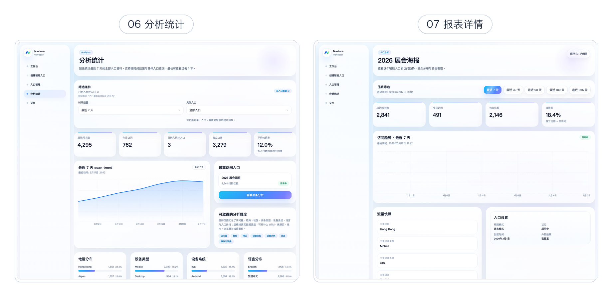

# Naviora

智能入口与动态二维码工作台。统一管理动态链接、二维码、分流规则和访问分析。

## 页面截图

下列截图来自本地运行的 Naviora 网页。拼图只并列真实页面并加标题，没有页面连线或绘制出来的界面；单页原图放在 `screenshots/pages/`。







单页截图：[首页](screenshots/01-homepage.png)、[登录](screenshots/pages/login.png)、[创建入口](screenshots/pages/create-entry.png)、[入口管理](screenshots/pages/entry-management.png)、[入口详情](screenshots/pages/entry-detail.png)、[文件中心](screenshots/pages/files.png)、[分析统计](screenshots/pages/analytics.png)、[报表详情](screenshots/pages/report-detail.png)。

截图使用本地演示数据。文件中心当前显示真实空状态；Supabase 未配置时，登录页只能展示界面，不能完成登录。

## 功能

- 管理动态链接与二维码入口
- 按语言、地区、设备、参数或 A/B 规则分流
- 查看访问趋势、地区、设备、语言和入口排行
- 通过三步创建流程配置入口并设计二维码

## 项目结构

- `apps/naviora-app`：产品网站与管理工作台
- `apps/naviora-go`：公开入口与跳转服务
- `supabase`：数据库迁移与 Supabase 配置
- `screenshots`：本地网页截图

## 本地运行

在仓库根目录安装依赖，然后为主应用创建本地环境文件：

```bash
npm ci
cp apps/naviora-app/.env.example apps/naviora-app/.env.local
```

编辑 `apps/naviora-app/.env.local`：

```dotenv
QWEN_API_KEY=你的阿里云百炼APIKey
QWEN_MODEL=qwen-plus
QWEN_API_BASE_URL=https://dashscope.aliyuncs.com/compatible-mode/v1
QWEN_LOCAL_TEST_MODE=true
```

如果使用专属 MaaS 兼容端点，将 `QWEN_API_BASE_URL` 改为对应的 `/compatible-mode/v1` 地址。只看页面截图或 mock 工作台时，Qwen Key 不是必需项。

`QWEN_LOCAL_TEST_MODE=true` 只在非生产环境生效。此模式供本地演示使用，会跳过 Supabase 登录、AI 配额检查和用量记录；生产环境仍要求 Supabase 配置。真实登录和持久化数据需要有效的 Supabase 环境变量。

启动主应用：

```bash
cd apps/naviora-app
npm run dev -- --webpack --hostname 127.0.0.1 --port 3001
```

常用页面：

- 首页：`http://127.0.0.1:3001/zh-Hans`
- 工作台：`http://127.0.0.1:3001/zh-Hans/dashboard`
- 入口管理：`http://127.0.0.1:3001/zh-Hans/qrs`
- 分析统计：`http://127.0.0.1:3001/zh-Hans/analytics`
- 创建入口：`http://127.0.0.1:3001/zh-Hans/qrs/new`

## 更新说明

详见 [CHANGELOG.md](CHANGELOG.md)。
